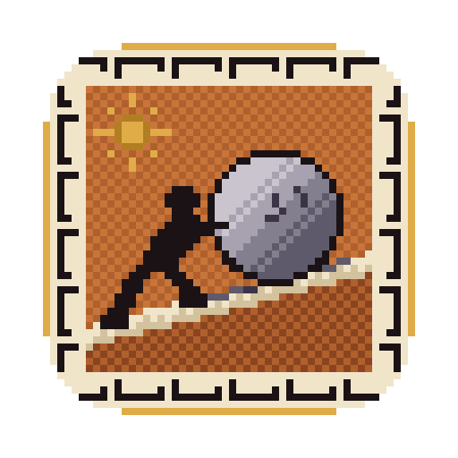
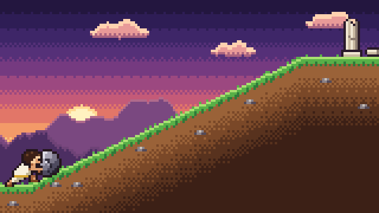

<p align="center"></p>

# Sisyphus

A task manager for a never-ending workflow.

[](https://github.com/zaterka/sisyphus/actions/workflows/release.yml)

## [⬇︎ Download for Mac](https://github.com/zaterka/sisyphus/releases/latest/download/Sisyphus.dmg)

Universal build for macOS 14 or later — Apple Silicon and Intel. Always the newest version.




## What is it?

Sisyphus is a lightweight task manager for the small and large tasks of your day — the ones that
have to be remembered, and the ones that keep being pushed to tomorrow. It lives in the corner of
the screen, in a borderless panel that floats above your other windows, and stays out of the way
until you look at it.

Tasks have a priority, a `#tag` and an optional due date, and you can drag the open ones into the
order you want to work through them.

When the list itself is more noise than help, the scene-only toggle hides it and leaves nothing but
the pixel-art scene: Sisyphus, his boulder and the hill.

The boulder is the progress bar — he climbs as you finish tasks. At the end of the day the rock
rolls back down. Don't worry, tomorrow we push it again.

*One must imagine Sisyphus happy.* — Albert Camus

## Install

You do not need a developer account, Homebrew or Terminal for this. It takes a minute.

1. **Download** [Sisyphus.dmg](https://github.com/zaterka/sisyphus/releases/latest/download/Sisyphus.dmg)
   and open the downloaded file.
2. **Drag Sisyphus** onto the Applications folder shown in the window, then eject the disk image.
3. **Open Sisyphus** from your Applications folder. macOS will block the first launch, because the
   app is not notarised by Apple — it says it cannot verify the developer. Close that dialog, but do
   **not** click **Move to Trash** / **Move to Bin**: that would delete the app. Then open
   **System Settings › Privacy & Security**, scroll down to the message about Sisyphus and click
   **Open Anyway**, and confirm. This is needed only once; after that Sisyphus opens normally.
   (The **Open Anyway** button only appears after one blocked launch attempt, so try to open the app
   first.)
4. If macOS instead says the app **is damaged**, that is the download quarantine flag. Open
   **Terminal** (Applications › Utilities) and paste this line, then press Return:

   ```sh
   xattr -dr com.apple.quarantine /Applications/Sisyphus.app
   ```

   Then open Sisyphus again.

Do not turn Gatekeeper off. The app is unsigned only because a paid Apple Developer account is not
worth it for a single-purpose utility; the steps above are the safe and intended way past it. Your
tasks never leave your Mac — see [Data](#data).

## Requirements

- To use the app: macOS 14 or later, on Apple Silicon or Intel.

## Features

- **Floating panel.** Borderless, always on top, visible on every Space, with a Dock icon. On
  launch it sits at the top-right of the main screen, 12 pt from the edges, and re-pins itself
  when the screen layout changes — unless you dragged it somewhere else using the grip in the
  toolbar.
- **Tasks.** Type in the add field and press Return. A `#word` anywhere in the text becomes the
  task's tag (`buy milk #home`). Each task has a title, a priority (none / low / medium / high,
  shown as a blue / orange / red dot), one tag, and an optional due date shown as "Today",
  "Tomorrow" or a short date.
- **Editing.** Click the pencil, double-click the row, or use the context menu to open the editor
  popover. Changes are applied when it closes. It also has a Delete button.
- **Reorder.** Drag open tasks to change their order.
- **Completed.** Ticking a task moves it to the collapsible "Completed (n)" section, where rows
  are struck through and dimmed. Tick it again to reopen it. Use the context menu to delete it,
  or "Clear completed" to remove them all.
- **Scene only.** The toolbar toggle (or ⌘T) hides the task list and leaves only the scene. The
  panel shrinks or grows with its top edge fixed, and the setting is remembered.

### Keyboard

These are ordinary menu shortcuts, so they work only while Sisyphus is the active app:

| Shortcut | Action |
|---|---|
| ⌘N | New task: shows the list if hidden and focuses the add field |
| ⌘T | Toggle the task list |
| ⌘H | Hide |
| ⌘Q | Quit |

The standard Edit shortcuts (⌘Z, ⇧⌘Z, ⌘X, ⌘C, ⌘V, ⌘A) work in the text fields.

### Focus trade-off

Clicking the panel activates Sisyphus, which takes focus from the app you were using. Without
this, the panel's text fields could not receive typing.

## How the mechanic works

Progress is

```
completedSinceReset / (completedSinceReset + open tasks)
```

`completedSinceReset` counts the tasks finished since the last time he reached the summit.

- **Adding** a task increases the denominator, so he slides back down a little.
- **Completing** a task increases the counter, so he climbs.
- **Reopening** a task undoes one completion.
- **Deleting** or clearing completed tasks does not take progress away.

He moves toward the target at a capped speed, so quick changes look like smooth pushing, not
jumps.

When no open tasks are left and at least one was completed, he reaches the **summit**:

1. He holds at the top for a moment.
2. The rock rolls all the way down and bounces.
3. He walks down after it and sits next to it.

The counter is then reset to zero. The sequence always plays to the end, and takes about 4.6
seconds. If you add a task while it is playing, he finishes the sequence, then stands up and
starts pushing again from the bottom.

Deleting the last open task also triggers the summit if you had completed something, because
there is nothing left to push. If you quit during the summit, it replays on the next launch.

With nothing left to push and nothing to be earned, he just walks back down to the boulder and
sits — no summit, no rolling rock. While he sits the scene runs at a reduced rate, so an idle
Sisyphus costs almost nothing.

## Data

Tasks are stored as JSON in `~/Library/Application Support/Sisyphus/tasks.json`.

- Saving waits 0.3 s after the last change, writes atomically, and also happens on quit.
- If the file cannot be decoded, it is renamed to `tasks.corrupt-<timestamp>.json` and the app
  starts empty instead of failing.
- The file location is logged at launch under the subsystem `com.sisyphus.app`.

## Development

Building, testing, the scripts and the release process are documented in
[`docs/DEVELOPMENT.md`](docs/DEVELOPMENT.md).

## License

Sisyphus is free software, released under the GNU General Public License, version 3 or later
(GPL-3.0-or-later): you may redistribute it and modify it under the terms of that license. The full
text is in [`LICENSE`](LICENSE).

It comes with absolutely no warranty, as the license says. The source is at
[github.com/zaterka/sisyphus](https://github.com/zaterka/sisyphus).

Copyright © 2026 Pedro Zaterka.
